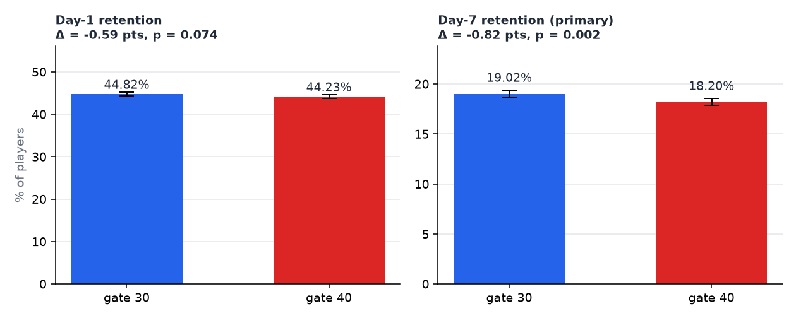

# Cookie Cats A/B test: read the experiment before reading the result

Analysis of a real mobile-game A/B test (90,189 players): should the first progress gate stay at level 30 or move to
level 40? The point of the project is the **process** an analyst should follow:

1. Validate the data and the randomisation.
2. Test the pre-declared primary metric.
3. Check guardrails and robustness.
4. Write a decision for a non-technical reader.



## Results (all from `reports/results.json`)

| | |
|---|---|
| Players | 90,189 (no duplicates, no missing values) |
| **Sample-ratio mismatch** | 44,700 vs 45,489, χ² = 6.90, **p = 0.0086**: the split is not the intended 50/50 |
| **Day-7 retention (primary)** | 19.02% → 18.20%, **−0.82 pts** (95% CI −1.33 to −0.31), p = 0.0016; bootstrap P(gate 40 worse) = 99.86% |
| Day-1 retention | 44.82% → 44.23%, −0.59 pts (95% CI −1.24 to +0.06), p = 0.074, not significant |
| Minimum detectable effect, day 7, 80% power | 0.74 pts. The observed effect is larger, so the test was powered |
| Guardrail: rounds played | median 17 vs 16, Mann-Whitney p = 0.050 |
| Robustness | without the 49,854-round outlier: −0.82 pts, p = 0.0016 |

**Decision:** keep the gate at level 30, and investigate the SRM before closing the test
([memo](docs/decision_memo.md)).

## Run it

```bash
pip install -r requirements.txt
python scripts/get_data.py         # downloads the data, verifies SHA-256
pytest -q                          # 5 tests: SRM, z-test (checked against statsmodels), bootstrap, MDE
python analysis/run_analysis.py    # -> reports/results.json + figure
```

## Decisions worth defending

- **SRM check comes first.** Most write-ups of this dataset skip it. A broken split can bias the result more than
  any statistical test can fix, so it is reported at the top, not hidden in an appendix.
- **Day-7 is the primary metric, day-1 secondary.** Picking the metric after seeing the results is p-hacking.
  Day-7 retention is closer to long-term value.
- **Both a z-test and a bootstrap.** They agree (CI −1.33 to −0.31 vs −1.31 to −0.30). The bootstrap also gives a
  number stakeholders understand: "99.9% chance level 40 is worse".
- **Medians and a rank test for rounds played.** The distribution is extremely skewed (mean 52, median 16, max
  49,854), so a t-test on means would be dominated by a few players.
- **No "players who reached the gate" subgroup.** Reaching level 30 happens after assignment, so conditioning on it
  introduces bias.

## Interview questions this project prepares for

1. What would you do if the SRM turned out to be caused by a logging bug?
2. Why is p = 0.074 on day-1 not "a trend towards significance"?
3. What is the difference between the MDE and the observed effect, and why does it matter here?
4. The test shows players leave earlier with gate 40. Why can't you say the gate *caused* boredom?


## Data and license

Code: MIT ([LICENSE](LICENSE)). Data: Cookie Cats A/B test data from [ryanschaub/Mobile-Games-A-B-Testing-with-Cookie-Cats](https://github.com/ryanschaub/Mobile-Games-A-B-Testing-with-Cookie-Cats). That repository states no license, so the file is **not** redistributed here: `python scripts/get_data.py` downloads it and checks its SHA-256.
